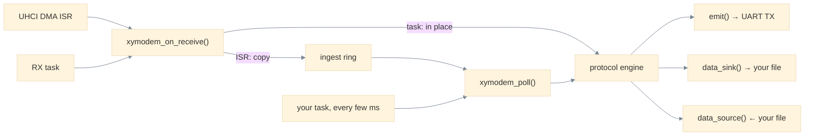

# X/YMODEM Programming Guide

You have a UART, and you want to move a file across it. That is the whole
problem this component solves.

XMODEM and YMODEM are two related answers to that problem, invented in the
era of 300-baud modems and still useful on an ESP chip talking to a host
tool, a second MCU, or a test bench. This guide teaches the wire protocol
first, then the C API that speaks it. Read it in order:

1. This page — how the library is shaped, and the five functions you will
   actually call.
2. [XMODEM](xmodem.md) — one file, no name, no exact length. Start here if
   you have never seen the protocol.
3. [YMODEM](ymodem.md) — the same packets, plus a filename, an exact size,
   and an optional batch of files.

The [API Reference](api.md) is generated from the public headers. The
narrative chapters point into it whenever a type or function first appears.

## The one idea

The library never reads the UART and never blocks. You already own the
hardware; you already have a task. The protocol engine is a state machine
you *feed* and *tick*:



[`xymodem_on_receive()`](api.md#function-xymodem_on_receive) copies only
when it must. From a UHCI ISR that is the copy-out-of-DMA before the
descriptor is recycled; from a task that already holds the bytes
(`uart_read_bytes`) the slice goes into the engine in place. Time on an
idle wire advances when you call [`xymodem_poll()`](api.md#function-xymodem_poll),
which also drains the ISR ring. Every byte that leaves the chip goes
through a callback you wrote, in **task** context. That is the entire
programming model.

Because the engine does not own the link, it also does not care whether the
bytes came from UART, USB CDC, a socket, or a unit-test buffer. You pick the
pipe; it speaks the protocol.

## Four callbacks, two start calls

[`xymodem_config_t`](api.md#struct-xymodem_config_t) is a 2×2 matrix. One
axis is *direction*, the other is *what the bytes are*:

| | Incoming (peer → you) | Outgoing (you → peer) |
|---|---|---|
| **Wire** (SOH, ACK, CRC, …) | [`xymodem_on_receive()`](api.md#function-xymodem_on_receive) | [`emit`](api.md#typedef-xymodem_emit_fn_t) |
| **Payload** (the file) | [`data_sink`](api.md#typedef-xymodem_data_sink_fn_t) | [`data_source`](api.md#typedef-xymodem_data_source_fn_t) |

Every callback's first argument is that same handle — the instance, the
`this` of this object — then `user_ctx`. An `emit` that only writes a UART
can ignore the handle today; it is still passed, so a later getter or one
callback serving several instances does not need a new signature. Do not
call back into the driver from a callback: the instance lock is held.

`emit` is required. The other two declare *capability*, not *what happens
next*:

- A device that only ever receives omits `data_source`.
- A device that only ever sends omits `data_sink`.
- An echo server registers both, then alternates
  [`xymodem_start_recv()`](api.md#function-xymodem_start_recv) and
  [`xymodem_start_send()`](api.md#function-xymodem_start_send).

There is no `protocol` field. XMODEM and YMODEM share every packet format,
every ACK/NAK, every timeout. YMODEM adds one optional packet at the start
of a file — block 0, carrying a name and a size — and, if you want several
files, repeats that pattern. The receiver recognises a header when it sees
one, and treats a header-less peer as classic XMODEM. The sender opts in by
passing a [`xymodem_file_info_t`](api.md#struct-xymodem_file_info_t) to
`xymodem_start_send()`, or passes `NULL` for classic XMODEM.

That is why the public API is small. Direction is chosen when a session
starts, not when the handle is created. The optional header is an argument,
not a mode switch. One handle, reused for the life of the task.

## Add the component

```bash
idf.py add-dependency "espressif/xymodem"
```

Then create the handle once, at init:

```c
#include "xymodem.h"

typedef struct {
    xymodem_handle_t handle;
    /* your file buffer, UART port, ... */
} app_t;

static app_t app;

static esp_err_t app_emit(xymodem_handle_t handle, void *ctx, const uint8_t *data, size_t len)
{
    (void)handle;
    (void)ctx;
    return uart_write_bytes(UART_NUM_1, data, len) == (int)len ? ESP_OK : ESP_FAIL;
}

static esp_err_t app_store(xymodem_handle_t handle, void *ctx, const uint8_t *data, size_t len)
{
    /* append `data[0..len)` to your file; return ESP_FAIL to abort */
    (void)handle; (void)ctx; (void)data; (void)len;
    return ESP_OK;
}

void app_init(void)
{
    xymodem_config_t cfg = {
        .core        = XYMODEM_CORE_CONFIG_DEFAULT(),
        .emit        = app_emit,     /* required */
        .data_sink   = app_store,    /* receive path */
        .data_source = NULL,         /* send path: omit if you never send */
        .on_file     = NULL,         /* YMODEM only; see that chapter */
        .on_event    = NULL,         /* optional lifecycle log */
        .user_ctx    = &app,
    };
    ESP_ERROR_CHECK(xymodem_new(&cfg, &app.handle));
    ESP_ERROR_CHECK(xymodem_start_recv(app.handle));
}
```

[`xymodem_new()`](api.md#function-xymodem_new) starts **idle**: nothing is
emitted, no timer runs. The first
[`xymodem_start_recv()`](api.md#function-xymodem_start_recv) (or
`xymodem_start_send()`) is what puts a byte on the wire.

A receive-only UART FIFO app is **one loop**. The `uart_read_bytes`
timeout *is* the poll period; status is watched in the same place:

```c
uint8_t wire[128];
for (;;) {
    int n = uart_read_bytes(UART_NUM_1, wire, sizeof(wire), pdMS_TO_TICKS(5));
    if (n > 0) {
        xymodem_on_receive(app.handle, wire, (size_t)n); /* task path: in place */
    }
    xymodem_poll(app.handle);
    if (xymodem_status(app.handle) == XYMODEM_ST_COMPLETE) {
        break;
    }
}
```

A UHCI / UART DMA ISR calls the same `xymodem_on_receive()` (that path
copies into the ingest ring — the copy-out-of-DMA). The loop then only
polls and watches status; there is still no extra RX task. If the ring
fills, the ISR path returns `ESP_ERR_NO_MEM` — enlarge `rx_buf_size`
(default 4096) or poll more often.

`xymodem_on_receive()` accepts any slice: half a packet, three packets, a
stray ACK mixed with data. `xymodem_poll()` drains ISR-ingested bytes and
advances timers. Forget to poll and an ISR-fed transfer never ACKs; an
idle handshake never times out.

## Watch a session finish

Do this from the task loop, **never from a callback**. Callbacks run with
the driver lock held; calling `xymodem_start_*()` from
[`on_event`](api.md#typedef-xymodem_event_fn_t) deadlocks.

```c
xymodem_status_t st = xymodem_status(handle);
if (st == XYMODEM_ST_COMPLETE) {
    /* file is in your sink; start the next session when you are ready */
} else if (st == XYMODEM_ST_FAILED) {
    xymodem_err_t why = xymodem_error(handle);
}
```

| Status | Meaning |
|---|---|
| [`XYMODEM_ST_IDLE`](api.md#enum-xymodem_status_t) | Handle created, no session yet |
| [`XYMODEM_ST_HANDSHAKE`](api.md#enum-xymodem_status_t) | Waiting for / sending the first request byte |
| [`XYMODEM_ST_TRANSFER`](api.md#enum-xymodem_status_t) | Packets are moving |
| [`XYMODEM_ST_COMPLETE`](api.md#enum-xymodem_status_t) | This session (or YMODEM batch) finished |
| [`XYMODEM_ST_FAILED`](api.md#enum-xymodem_status_t) | See [`xymodem_error()`](api.md#function-xymodem_error) |

Optional events, if you registered `on_event`. The list is deliberately
short: every event is something you **cannot** observe through your own
callbacks — block arrivals are exactly your `data_sink` calls, payload pulls
are exactly your `data_source` calls, and a block-0 header is `on_file`.

| Event | When |
|---|---|
| [`XYMODEM_EV_FILE_COMPLETE`](api.md#enum-xymodem_event_t) | One YMODEM file ended; the batch may continue |
| [`XYMODEM_EV_COMPLETE`](api.md#enum-xymodem_event_t) | The session / batch is done |
| [`XYMODEM_EV_FAILED`](api.md#enum-xymodem_event_t) | `arg` is the `XYMODEM_ERR_*` code |

### Recipe: a progress bar

Progress is not an API — it is a counter in the callback you already wrote:

```c
/* receiver: bytes landed so far; on_file restarts the count per file */
static esp_err_t store(xymodem_handle_t h, void *ctx, const uint8_t *d, size_t len)
{
    app->received += len;                      /* progress */
    app->percent = 100 * app->received / app->size;  /* size from on_file */
    return store_to_flash(d, len);
}

/* sender: bytes handed to the engine */
static esp_err_t load(xymodem_handle_t h, void *ctx, uint8_t *buf, size_t len, size_t *read_len)
{
    size_t n = read_from_source(buf, len);
    *read_len = n;
    app->sent += n;                            /* progress */
    return ESP_OK;
}
```

No duplicates reach the callbacks (the engine ACKs them but does not deliver
them twice), so the counters are exact.

A session already in flight is not silently replaced:
`xymodem_start_recv()` / `xymodem_start_send()` return
`ESP_ERR_INVALID_STATE`. Wait for `COMPLETE` or `FAILED`, then start the
next one. The same handle is reused; you do not call
[`xymodem_new()`](api.md#function-xymodem_new) per file.

If `emit`, `data_sink` or `data_source` returns anything other than
`ESP_OK`, the engine aborts immediately with
[`XYMODEM_ERR_IO`](api.md#enum-xymodem_err_t), emits two CAN bytes, and
does not ACK or send EOT afterwards. The failed operation did not happen;
pretending the file is complete would be worse.

## Defaults you can leave alone

[`XYMODEM_CORE_CONFIG_DEFAULT()`](api.md#define-xymodem_core_config_default)
is the right starting point:

| Field | Default | Role |
|---|---|---|
| `check_mode` | `XYMODEM_CHECK_AUTO` | `'C'` three times, then NAK/checksum |
| `block_1k` | `false` | Sender uses 128-byte packets; receiver accepts both sizes anyway |
| `max_retries` | `10` | Christensen's original retry budget |
| `packet_timeout_ms` | `3000` | Receiver re-requests after this much silence |
| `response_timeout_ms` | `30000` | Sender gives up waiting for ACK/NAK |

Keep `response_timeout_ms` several times larger than `packet_timeout_ms`.
The receiver is supposed to talk first and to talk again on timeout; the
sender should wait for it.

## What this component does not do

- **YMODEM-G.** Streaming without per-block ACK. The stop-and-wait machine
  would have to be a different machine.
- **Owning a UART.** Console, pins, baud rate, and which port is the
  protocol pipe are yours. The example uses USB Serial/JTAG for logs and a
  second UART for XMODEM; that split is an application choice.
- **Xtensa.** The Rust engine builds for RISC-V RV32 (the triple is derived
  from IDF's `CONFIG_IDF_TARGET_ARCH` / `CONFIG_SOC_CPU_HAS_FPU`).

The full receive-then-echo demo is
[`examples/xymodem_event`](../../examples/xymodem_event). It is the same
firmware for both protocols: the host tool decides whether to send a
header. For a real deployment — firmware updates streamed through UHCI
(UART DMA) with a sha256-verified boot switch — see
[`examples/xymodem_ota`](../../examples/xymodem_ota).

## Next

If you have never seen XMODEM, the [XMODEM chapter](xmodem.md) walks one
file across the wire, byte by byte, and then writes the matching
`data_sink` / `data_source`. If you already know XMODEM and want a
filename and an exact length, skip to [YMODEM](ymodem.md).
