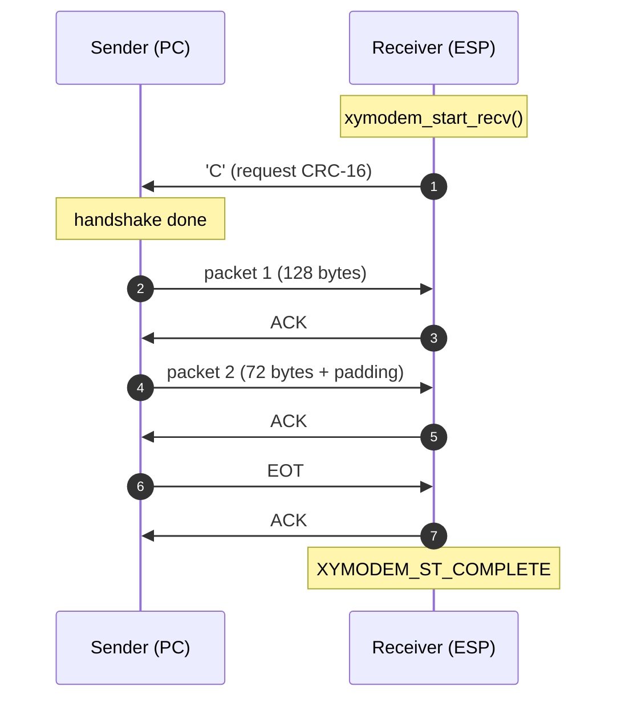
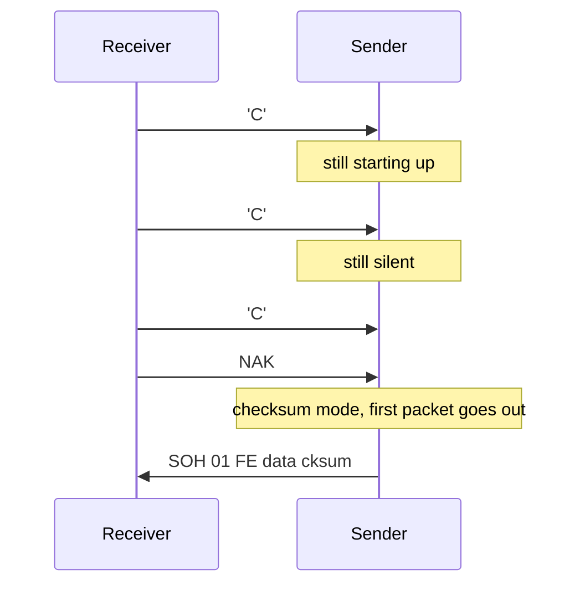
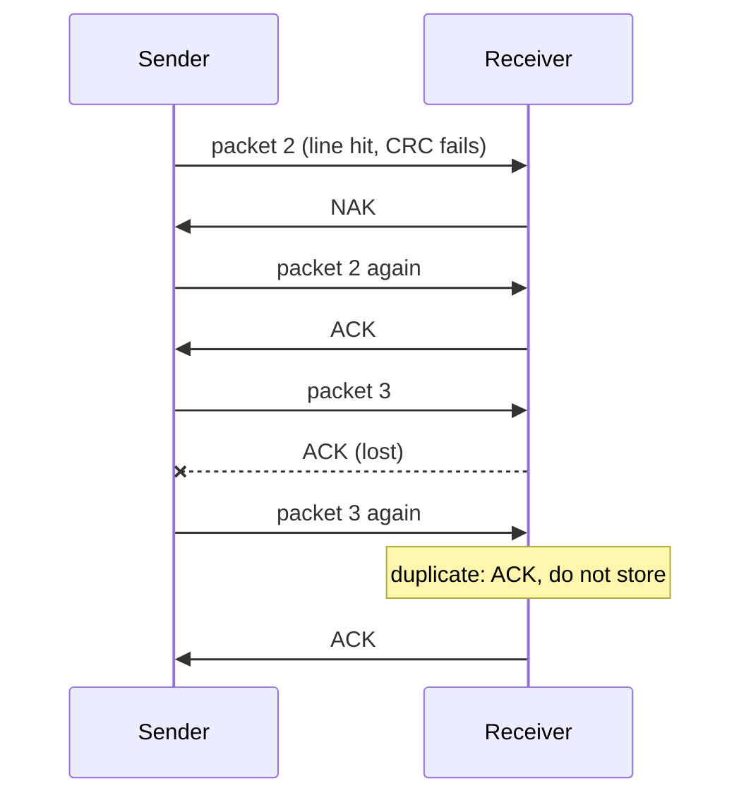

# XMODEM

A UART gives you a stream of bytes. It does not tell you where a file
starts, where it ends, or whether a byte was flipped on the way. XMODEM is
a small set of rules that add those three things, invented by Ward
Christensen in 1977 and written down in 1982.

This chapter is the 1982 protocol, plus the two extensions every modern
tool actually speaks: CRC-16 instead of a one-byte checksum, and optional
1024-byte packets. YMODEM is [the next chapter](ymodem.md); it is XMODEM
with one extra packet.

The official references are linked at the bottom. Where Christensen's 1982
note disagrees with later practice, the disagreement is called out rather
than smoothed over.

## Case: a PC sends firmware.bin to the chip

You have a 200-byte image. You want it in RAM on the ESP. The PC runs
`sx firmware.bin` (or the Python `xmodem` package, or minicom's XMODEM
upload). The chip is the **receiver**. That is the usual direction, and
XMODEM is **receiver-driven**: the receiver talks first, and the sender
does not emit a data byte until it is asked.



Three facts fall out of that picture, and they are the whole protocol:

1. The receiver starts the transfer.
2. Data moves in fixed-size packets, each acknowledged before the next one.
3. The sender says "no more packets" with a single byte, EOT; the receiver
   acknowledges it, and the file is done.

The rest of this chapter is those three facts in enough detail to write the
callbacks.

## The alphabet

XMODEM uses a handful of control bytes. They are ordinary 8-bit values;
nothing is escaped, and a payload byte that happens to equal SOH is still
payload — the packet length is what delimits it.

| Byte | Hex | Name | Who sends it |
|---|---|---|---|
| SOH | `0x01` | Start of 128-byte packet | Sender |
| STX | `0x02` | Start of 1024-byte packet (XMODEM-1K) | Sender |
| EOT | `0x04` | End of transmission | Sender |
| ACK | `0x06` | Accept this packet / EOT | Receiver |
| NAK | `0x15` | Reject / please send (checksum mode) | Receiver |
| CAN | `0x18` | Cancel (two in a row) | Either |
| `'C'` | `0x43` | Please send, CRC-16 mode | Receiver |
| SUB | `0x1A` | Padding in the last packet | Sender |

Christensen's 1982 document lists ACK as `05H`. That is a well-known typo
for ASCII ACK, which is `06H`. This component, and every XMODEM
implementation in common use, sends `0x06`.

The link is 8 data bits, no parity, one stop bit. The protocol does not
care about baud rate.

## A packet is a box of 128 bytes

There are no short packets. If the file is 200 bytes, the sender still
emits two 128-byte payloads; the leftover 56 bytes of the second box are
filled with SUB (`0x1A`, CP/M's end-of-file marker). Classic XMODEM has no
way to tell the receiver "ignore those 56 bytes", so `data_sink` is handed
the whole block, padding included. That is not a quirk of this library; it
is the 1982 rule. YMODEM's length field is how you get the exact size back.

```
 0      1      2      3                         130     131
+------+------+------+--------------------------+------+
| SOH  | blk  | ~blk |  128 payload bytes       | cksum|
| 0x01 |  n   | 255-n|  data, padded with 0x1A  |      |
+------+------+------+--------------------------+------+
```

- `blk` starts at 1, increments by 1, and wraps from 255 to 0 (not back to
  1). Christensen: *"wraps 0FFH to 00H (not to 01)"*.
- `~blk` is the ones' complement. If `blk ^ ~blk` is not `0xFF`, the packet
  is garbage; NAK it.
- `cksum` is the arithmetic sum of the 128 payload bytes, modulo 256. Carry
  is thrown away.

CRC-16 replaces the one-byte checksum with a two-byte CRC (poly `0x1021`,
init 0, no reflection — CRC-16/XMODEM), sent big-endian:

```
 0      1      2      3                         130     131     132
+------+------+------+--------------------------+------+------+
| SOH  | blk  | ~blk |  128 payload bytes       | CRC  | CRC  |
| 0x01 |  n   | 255-n|                          |  hi  |  lo  |
+------+------+------+--------------------------+------+------+
```

XMODEM-1K is the same layout with STX (`0x02`) instead of SOH and 1024
payload bytes. The receiver accepts a mixture of SOH and STX; the start
byte is the length. The sender must not change size on a packet that has
not yet been ACKed.

## Handshake: the receiver talks first

Christensen: the receiver has a timeout in the order of ten seconds. Each
time it fires, the receiver sends NAK. The first NAK is what wakes a
sender that is sitting idle. Optionally the receiver sends NAK immediately
rather than waiting for the first timeout; this component sends its request
byte immediately at `start_recv` (that is `'C'` in the default AUTO/CRC16
mode, NAK only when SUM8 is forced).

CRC-16 is requested by sending `'C'` (`0x43`) instead of NAK, for the
**first** packet only. If the sender is an old checksum-only program, it
will not understand `'C'` and will stay silent. Common XMODEM-CRC practice
— and this component's [`XYMODEM_CHECK_AUTO`](api.md#enum-xymodem_check_mode_t)
— is to try `'C'` three times, then fall back to NAK:



Forcing the mode is a config field, not a different API:

```c
cfg.core = XYMODEM_CORE_CONFIG_DEFAULT();
cfg.core.check_mode = XYMODEM_CHECK_AUTO;   /* default: 3 × 'C', then NAK */
/* cfg.core.check_mode = XYMODEM_CHECK_CRC16;  // never fall back */
/* cfg.core.check_mode = XYMODEM_CHECK_SUM8;   // NAK from the first byte */
```

The sender waits. It emits nothing until it sees NAK or `'C'`. That wait
is [`xymodem_start_send(handle, NULL)`](api.md#function-xymodem_start_send)
— the `NULL` is "no block 0, this is classic XMODEM". As soon as the
request byte arrives, your [`data_source`](api.md#typedef-xymodem_data_source_fn_t)
is called for the first payload chunk and the first data packet goes out.

## The data loop

For every packet the receiver:

1. Checks that `blk ^ ~blk == 0xFF` and that the checksum/CRC matches.
   Otherwise NAK, after dropping any half-finished bytes so the next SOH
   is seen cleanly.
2. If `blk` is the expected number: deliver the 128 (or 1024) bytes to
   [`data_sink`](api.md#typedef-xymodem_data_sink_fn_t), ACK, expect
   `blk + 1`.
3. If `blk` is the previous number: the ACK was lost and the sender
   retransmitted. ACK again, **do not** deliver the payload a second time.
4. Any other `blk`: fatal loss of sync. Abort with two CAN bytes,
   [`XYMODEM_ERR_OUT_OF_SYNC`](api.md#enum-xymodem_err_t).



`data_sink` is called only for step 2. Returning anything other than
`ESP_OK` aborts with [`XYMODEM_ERR_IO`](api.md#enum-xymodem_err_t) and
does **not** ACK, so the peer can retry. Returning `ESP_OK` after storing
the bytes is what makes the ACK legitimate.

## EOT

When the sender has no more data it sends EOT (`0x04`) and waits for ACK.
Christensen: if the ACK does not arrive, resend EOT.

Some later receivers (YAM, and Forsberg's YMODEM figures) NAK the first
EOT, to make sure a data packet is not still in flight, and ACK the
second. This component, as a receiver, ACKs the first EOT — Christensen's
rule. As a sender, if the peer NAKs EOT, it resends, so a YAM-style
receiver still completes.

If the sender never sees an ACK of EOT and exhausts its retries, it still
completes successfully: every data packet was already ACKed, and the
receiver has often already moved on. Completing the file is more honest
than reporting a failure after the payload has landed.

## Cancel

A single CAN (`0x18`) is treated as line noise: an ACK or SOH that got
hit can look like CAN, which is why Christensen never made a one-byte
abort standard. Two CANs — even with a few stray bytes between them —
cancel the transfer
([`XYMODEM_ERR_CANCEL_BY_PEER`](api.md#enum-xymodem_err_t)).

[`xymodem_cancel()`](api.md#function-xymodem_cancel) is the local
equivalent: it emits two CANs and reports
[`XYMODEM_ERR_CANCEL_BY_LOCAL`](api.md#enum-xymodem_err_t).
A peer cancel is not echoed — that would start a CAN storm.

## Case 1: receive, in C

The application owns three things: the UART, a place to put bytes, and a
clock. The library owns none of them.

```c
#define CAP 4096

typedef struct {
    xymodem_handle_t handle;
    uint8_t  buf[CAP];
    size_t   used;
} app_t;

static esp_err_t emit(xymodem_handle_t handle, void *ctx, const uint8_t *data, size_t len)
{
    (void)handle;
    (void)ctx;
    return uart_write_bytes(UART_NUM_1, data, len) == (int)len ? ESP_OK : ESP_FAIL;
}

static esp_err_t store(xymodem_handle_t handle, void *ctx, const uint8_t *data, size_t len)
{
    (void)handle;
    app_t *app = ctx;
    if (app->used + len > sizeof(app->buf)) {
        return ESP_ERR_NO_MEM;          /* abort: XYMODEM_ERR_IO, no ACK */
    }
    memcpy(app->buf + app->used, data, len);
    app->used += len;
    return ESP_OK;
}

void app_main(void)
{
    static app_t app;
    xymodem_config_t cfg = {
        .core      = XYMODEM_CORE_CONFIG_DEFAULT(),
        .emit      = emit,
        .data_sink = store,
        .user_ctx  = &app,
    };
    /* uart_driver_install / uart_set_pin omitted */
    ESP_ERROR_CHECK(xymodem_new(&cfg, &app.handle));

    app.used = 0;
    ESP_ERROR_CHECK(xymodem_start_recv(app.handle));

    /* One loop. The uart_read_bytes timeout is the poll period.
     * A UHCI ISR would call xymodem_on_receive() itself; this loop
     * would then only poll and watch status. */
    uint8_t wire[128];
    for (;;) {
        int n = uart_read_bytes(UART_NUM_1, wire, sizeof(wire), pdMS_TO_TICKS(5));
        if (n > 0) {
            xymodem_on_receive(app.handle, wire, (size_t)n);
        }
        xymodem_poll(app.handle);
        int st = xymodem_status(app.handle);
        if (st == XYMODEM_ST_COMPLETE) {
            /* app.buf[0 .. app.used) is the file, SUB padding included */
            break;
        }
        if (st == XYMODEM_ST_FAILED) {
            /* e.g. the buffer filled up: xymodem_error() says why */
            break;
        }
    }
}
```

That is a complete XMODEM receiver. `xymodem_start_recv()` emits the first
`'C'` immediately. The Python side, against the same UART, is:

```python
import serial
from xmodem import XMODEM

uart = serial.Serial('/dev/ttyUSB0', 115200, timeout=1)
modem = XMODEM(lambda n, t=1: uart.read(n) or None,
               lambda d, t=None: uart.write(d))
with open('firmware.bin', 'rb') as f:
    modem.send(f)
```

After `COMPLETE`, `app.used` is a multiple of 128 (or 1024). Trim trailing
SUB yourself if you know the file is text; if you need the exact length on
the wire, that is [YMODEM](ymodem.md).

## Case 2: send, in C

Same handle, opposite direction. `data_source` is pull-based: the engine
asks for the next chunk when it is ready to build a packet. Returning
`*read_len = 0` means "no more data, send EOT". A short read is the last
block; the engine pads it with SUB.

```c
static esp_err_t load(xymodem_handle_t handle, void *ctx, uint8_t *buf, size_t len, size_t *read_len)
{
    (void)handle;
    app_t *app = ctx;
    size_t remain = app->used - app->read_pos;
    size_t n = remain < len ? remain : len;
    memcpy(buf, app->buf + app->read_pos, n);
    app->read_pos += n;
    *read_len = n;
    return ESP_OK;
}
```

Register it at `xymodem_new()` time (`data_source = load`), then, when you
want to send:

```c
app.read_pos = 0;
ESP_ERROR_CHECK(xymodem_start_send(app.handle, NULL));  /* NULL = classic */
```

The engine now waits for the peer's `'C'` or NAK. You still feed
`xymodem_on_receive()` and `xymodem_poll()`. When `XYMODEM_ST_COMPLETE`
arrives, the peer has ACKed EOT.

`NULL` is doing real work here. It is how you say "do not put a filename
on the wire". The same function, with a
[`xymodem_file_info_t`](api.md#struct-xymodem_file_info_t), is YMODEM.
There is no second send API.

## XMODEM-1K

1024-byte packets are a **sender** choice. XMODEM has no byte that means
"please send me 1K"; a receiver simply accepts STX as well as SOH. Set it
on the sender:

```c
cfg.core.block_1k = true;
```

When the remaining payload is at most 128 bytes, this component emits a
final SOH/128 packet rather than a 1024-byte packet full of SUB. That is
the mixed sizing Forsberg's reference shows in figure 2 ("Mixed 1024 and
128 byte Packets"). The receiver does not need to be told.

CRC-16 should be used with 1K packets. `XYMODEM_CHECK_AUTO` already
prefers CRC. A checksum-only peer is still accepted; the sender follows
whatever the receiver requested. Under no circumstances does a sender use
CRC-16 unless the receiver asked for it with `'C'` — that is Forsberg's
rule, and the handshake enforces it.

## Timeouts and retries

Christensen: the receiver times out in ten seconds and NAKs; errors are
retried ten times. This component keeps the ten-retry budget and shortens
the silence to 3 s / 30 s, which fits a local UART better than a 1982
phone line. Override them if you are on a slow or lossy link:

```c
cfg.core.packet_timeout_ms   = 10000;  /* receiver re-request */
cfg.core.response_timeout_ms = 60000;  /* sender waiting for ACK */
cfg.core.max_retries         = 10;
```

`packet_timeout_ms` is the receiver's "the line went quiet, ask again".
`response_timeout_ms` is the sender's "the receiver has not ACKed, resend
the same packet". They are not two names for the same timer. The sender
is not supposed to emit unsolicited data; if its ACK is lost, it
retransmits the last packet, and the receiver's duplicate rule (ACK, do
not store) makes that safe.

## Status of the design, for XMODEM

You do not configure "I am an XMODEM device". You create a handle, attach
a pipe (`emit` + `on_receive`), attach a file (`data_sink` and/or
`data_source`), and call `start_recv` or `start_send(…, NULL)`. The
handshake byte, the packet layout, the duplicate rule and EOT are then
the engine's problem.

The next chapter adds one packet and reuses everything you just learned.

## References

- Ward Christensen, *Xmodem Protocol Overview*, 1 Jan 1982:
  <https://www.menie.org/georges/embedded/xmodem_specification.html>
- Chuck Forsberg, *XMODEM/YMODEM Protocol Reference*, 11 Sep 1986
  (CRC-16, XMODEM-1K, YMODEM batch):
  <https://techheap.packetizer.com/communications/modems/xmodem-ymodem_reference.html>
