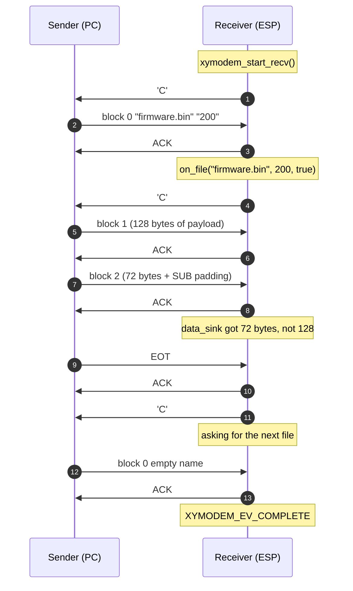
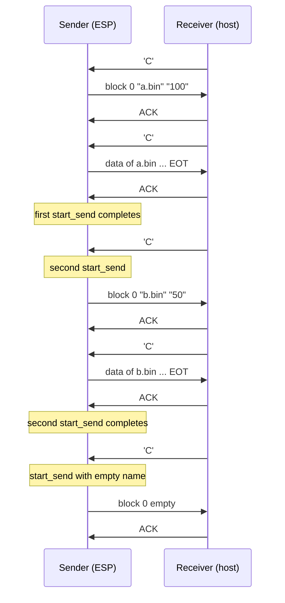

# YMODEM

YMODEM is XMODEM/CRC, optional 1K packets, plus a way to send the file's
name and length, and a way to send several files in one go. Chuck
Forsberg's 1986 reference defines it that way, word for word. If you have
not read the [XMODEM chapter](xmodem.md), start there: every data packet,
every ACK/NAK, every EOT in this chapter is the packet you already know.

What XMODEM cannot tell the receiver:

- what the file is called
- how long it really is (the last packet is padded with SUB to 128 or 1024)

YMODEM answers both with **block 0**: a normal 128-byte SOH packet whose
block number is 0, sent before block 1, carrying a name and an optional
size. After that, the file contents are ordinary XMODEM.

## Case: the PC sends firmware.bin, 200 bytes

Same UART as the XMODEM example. The PC now runs `sb firmware.bin` (or
the Python `ymodem` package). The chip still calls
[`xymodem_start_recv()`](api.md#function-xymodem_start_recv) — there is no
YMODEM-specific start function. The first packet is what changes.



Four things are new, and they are the whole of YMODEM:

1. The first packet has block number 0 and is a header, not file data.
2. After the header is ACKed, the receiver sends `'C'` **again**, and the
   file contents follow as XMODEM starting at block 1.
3. Because the header carried `200`, `data_sink` is given 200 bytes, not
   256. The SUB padding never reaches you.
4. After EOT, the receiver asks for the next file with `'C'`. An empty
   name in block 0 means "no more files".

The receiver did not have to be told "this will be YMODEM". A classic
sender that starts with block 1 is still accepted; `on_file` is simply
never called. That is why there is no protocol enum on
[`xymodem_config_t`](api.md#struct-xymodem_config_t).

## Block 0

Forsberg: the receiver initiates with `'C'`. The sender opens the first
file and sends packet number 0. Only the pathname is required; unused
bytes in the packet **must** be null, so older programs can ignore fields
they do not know.

```
 0      1      2      3                                    130     131     132
+------+------+------+-------------------------------------+------+------+
| SOH  |  00  |  FF  |  name, NUL, size, NUL, zeros...     | CRC  | CRC  |
+------+------+------+-------------------------------------+------+------+
                       <------------ 128 bytes ----------->
```

The 128 data bytes, as this component writes them:

```
firmware.bin \0 200 \0 00 00 00 ... 00
```

- Name: a NUL-terminated ASCII string. No spaces. Drive letters are not
  sent. Directories, if you really mean them, use `/` not `\`.
- Length: optional in the spec, a **decimal** ASCII count of file bytes,
  not including SUB padding. This component always sends it when the name
  is non-empty, and always parses it when present.
- Modification date (octal seconds since 1970), Unix mode, and serial
  number are further optional fields, each separated by a single space,
  and "fields may not be skipped". This component does not send them.
  A header of `name NUL size NUL` is what VMS `rb`/`sb` send, and what
  Forsberg's table lists as a valid subset. Receivers that insist on an
  octal date after the size (Pro-YAM's default style) need a style flag
  on the **host** tool; the wire we emit is spec-legal.

An empty name — the first data byte is NUL, the rest zeros — is the
batch terminator. It carries no payload. The receiver ACKs it and the
session completes.

YMODEM is CRC-16 only. A header-ful sender ignores a NAK during the
header handshake (`'C'` is what asks for block 0). After the header is
ACKed, a NAK means "the `'C'` for block 1 was lost, send block 1", not
"switch to checksum".

## `on_file`: accept or refuse before any payload

[`xymodem_on_file_fn_t`](api.md#typedef-xymodem_on_file_fn_t) fires after
block 0 verifies and **before** any `data_sink` call. Forsberg: if the
write-open fails, cancel with CAN. Returning `false` is that cancel
([`XYMODEM_ERR_FILE_REJECTED`](api.md#enum-xymodem_err_t),
not `XYMODEM_ERR_IO` — the plumbing worked, you refused the file).

```c
static bool on_file(xymodem_handle_t handle, void *ctx, const char *name, uint64_t size, bool has_size)
{
    (void)handle;
    app_t *app = ctx;
    if (has_size && size > sizeof(app->buf)) {
        return false;                  /* CAN, FILE_REJECTED */
    }
    strlcpy(app->name, name, sizeof(app->name));
    app->expect = has_size ? size : 0;
    return true;                       /* ACK block 0, then 'C' for block 1 */
}
```

`name` is only valid during the call; copy it if you need it later.
`has_size` is false for a header that carried a name and nothing else
(CP/M YAM does this). Payload is then delivered the classic way: whole
blocks, SUB included, exact length unknown.

Register it next to the other callbacks:

```c
xymodem_config_t cfg = {
    .core      = XYMODEM_CORE_CONFIG_DEFAULT(),
    .emit      = emit,
    .data_sink = store,
    .on_file   = on_file,
    .user_ctx  = &app,
};
```

A classic XMODEM sender never emits block 0, so `on_file` is never
called. You can leave it registered.

## Case 1: receive a named file

The receive path is the XMODEM one plus `on_file`.
[`xymodem_start_recv()`](api.md#function-xymodem_start_recv) is unchanged.

```c
app.used = 0;
app.name[0] = '\0';
ESP_ERROR_CHECK(xymodem_start_recv(app.handle));

for (;;) {
    vTaskDelay(pdMS_TO_TICKS(100));
    int st = xymodem_status(app.handle);
    if (st == XYMODEM_ST_COMPLETE) {
        /* app.name, app.used — size matches the header when has_size */
        break;
    }
    if (st == XYMODEM_ST_FAILED) {
        /* xymodem_error() is FILE_REJECTED, IO, ... */
        break;
    }
}
```

Events, if you care to log them:

| Event | YMODEM receive |
|---|---|
| `on_file` | Block 0 accepted — this is the receiver-side handshake |
| `XYMODEM_EV_FILE_COMPLETE` | This file's EOT; the session stays open for the next header |
| `XYMODEM_EV_COMPLETE` | Empty block 0, or the sender went silent after EOT |

There is no handshake event: a YMODEM receiver already has `on_file` for
"the header landed", and a classic receiver's first `data_sink` call marks
the same moment.

A single-file host tool (`sb one_file`) often skips the empty terminator.
After EOT the receiver sends `'C'` and waits a couple of packet timeouts;
silence is treated as a successful end. You still see `COMPLETE`. You
may also see `FILE_COMPLETE` first.

## Case 2: send a named file

The sender opts into a header by passing metadata, not by flipping a
mode:

```c
xymodem_file_info_t file = {
    .name = "firmware.bin",   /* copied; this pointer may go out of scope */
    .size = 200,              /* exact byte count, no padding */
};
ESP_ERROR_CHECK(xymodem_start_send(handle, &file));
```

`data_source` is the same pull callback as classic XMODEM. The engine
sends block 0 (name + decimal size + CRC-16), waits for ACK, waits for
the second `'C'`, then pulls payload for block 1, 2, … and EOT.

The name must be NUL-terminated and must fit in the 128-byte header
together with the decimal size. Too long, or a NUL in the middle of the
name, is `ESP_ERR_INVALID_ARG` from `xymodem_start_send()` — the session
does not start, nothing hits the wire.

`.size = 0` with a non-empty name is a valid empty file, not a
terminator. The terminator is an empty name, next section.

## Case 3: a batch of two files

Forsberg, figure 3: after a file's EOT is done, the receiver sends `'C'`
for the next pathname. A NUL pathname ends the batch. Zero files is not
necessarily an error (none of the requested names could be opened).

This library keeps **no batch state**. The wire timing *is* the batch:

- **Receiver.** One [`xymodem_start_recv()`](api.md#function-xymodem_start_recv)
  handles the whole batch. Each non-empty block 0 calls `on_file` and
  resets the block counter to 1. Each file EOT fires
  [`XYMODEM_EV_FILE_COMPLETE`](api.md#enum-xymodem_event_t).
  The empty header fires [`XYMODEM_EV_COMPLETE`](api.md#enum-xymodem_event_t).
  Close or rename the current file in `FILE_COMPLETE` so `on_file` can
  open the next one.

- **Sender.** Several
  [`xymodem_start_send()`](api.md#function-xymodem_start_send) calls, one
  file each, then one call with an empty name. Each call waits for the
  receiver's fresh `'C'`, which is exactly the YMODEM batch cadence.
  Wait for `XYMODEM_ST_COMPLETE` between calls — starting on top of an
  in-flight session is `ESP_ERR_INVALID_STATE`.

  That `'C'` usually arrives while the previous session has just completed
  (the receiver sends it immediately after ACKing EOT). The engine answers
  nothing then — this session is over, and the `'C'` asks for the *next*
  header, not for a retransmit — so the receiver re-requests `'C'` after its
  own timeout, and the next `start_send()` answers that one. One receiver
  timeout cycle per batch boundary; that is the price of the batch living in
  the application instead of a library state machine.



```c
static const xymodem_file_info_t files[] = {
    { .name = "a.bin", .size = 100 },
    { .name = "b.bin", .size =  50 },
};

/* after each COMPLETE, from the task loop, never from on_event: */
if (index < 2) {
    point_data_source_at(files[index]);          /* your bookkeeping */
    xymodem_start_send(handle, &files[index]);
    index++;
} else if (index == 2) {
    xymodem_file_info_t end = { .name = "", .size = 0 };
    xymodem_start_send(handle, &end);
    index++;
}
```

The empty-name session sends block 0 and no payload. Its `COMPLETE` is
the end of the batch.

That split — receiver holds the batch open, sender sequences files with
plain `start_send` — is the "less is more" part. A batch state machine
inside the library would have to know how many files you have, what they
are called, and when you are done. You already know those things. The
protocol already has a token for "done" (empty block 0) and a token for
"next" (the receiver's `'C'`). The API is those tokens, not a wrapper
around them.

## EOT in a batch

Forsberg's figure 3 shows the receiver NAKing the first EOT and ACKing
the second. That is YAM's "make sure no data is still in flight"
enhancement. Christensen's XMODEM ACKs the first EOT.

This component, as a receiver, ACKs the first EOT and immediately sends
`'C'` for the next header. As a sender, a NAK of EOT is answered by
resending EOT, so a YAM-style peer still finishes. Either figure on the
wire is therefore interoperable; the one we emit as receiver is
Christensen's.

A late EOT after we already ACKed (the sender missed the ACK) is ACKed
again. We do not send a second `'C'` with it: a sender waiting for EOT's
ACK would treat `'C'` as NAK-of-EOT and loop.

## 1K packets and mixed last blocks

YMODEM data packets may mix SOH/128 and STX/1024. Block numbers still go
1, 2, 3, … regardless of size. The sender must not change size on a
packet that has not been ACKed.

[`block_1k`](api.md#struct-xymodem_core_config_t) is still a sender
choice, as in XMODEM. When the remaining payload fits in 128 bytes, this
component sends SOH rather than a 1K packet of SUB. Forsberg's "mixed
1024 and 128 byte packets" figure is exactly that.

The length in block 0 is what lets the receiver discard padding. Without
a length (`has_size == false`), delivery is classic: whole blocks.

## What YMODEM-G is, and why it is absent

YMODEM-g replaces `'C'` with `'G'`. The sender then streams every packet
without waiting for ACK. It is meant for error-correcting links. A single
lost byte ruins the file, and the stop-and-wait state machine in this
component would have to become a streaming one. It is not implemented;
a `'G'` from the peer is not a supported handshake.

KMD/IMP's `CK` trigger ("send me 1K") is also out. Forsberg already
warns that timesharing systems can split the two characters by seconds.
1K remains a local config bit on the sender.

## The same handle, both protocols

Putting the two chapters next to each other:

| | XMODEM | YMODEM |
|---|---|---|
| Start receiving | `xymodem_start_recv()` | the same call |
| Start sending | `xymodem_start_send(h, NULL)` | `xymodem_start_send(h, &file)` |
| First packet | block 1, payload | block 0, name + size |
| Exact file length | unknown (SUB padded) | `on_file(..., size, true)` |
| Several files | start a new session per file | receiver: one session; sender: one `start_send` per file, then empty name |
| End of one file | EOT → `COMPLETE` | EOT → `FILE_COMPLETE`, then next header or `COMPLETE` |

[`examples/xymodem_event`](../../examples/xymodem_event) is one firmware
that does both. The host's choice of `xmodem.send()` versus `ymodem.send()`
is what picks the column. The chip's `on_file` either fires or it does
not; the echo then uses `start_send(h, NULL)` or `start_send(h, &file)`
accordingly, and an empty-name call closes a YMODEM batch so the host
tool sees a well-formed session.

That is the whole public surface. Everything else — CRC fallback, 1K,
retries, CAN, duplicate blocks — is XMODEM, running underneath.

## References

- Chuck Forsberg, *XMODEM/YMODEM Protocol Reference*, 11 Sep 1986,
  chapter 4 (batch, block 0, figures 1–5) and chapter 5 (YMODEM-g):
  <https://techheap.packetizer.com/communications/modems/xmodem-ymodem_reference.html>
- Ward Christensen, *Xmodem Protocol Overview*, 1 Jan 1982 (the data
  packets YMODEM reuses):
  <https://www.menie.org/georges/embedded/xmodem_specification.html>
